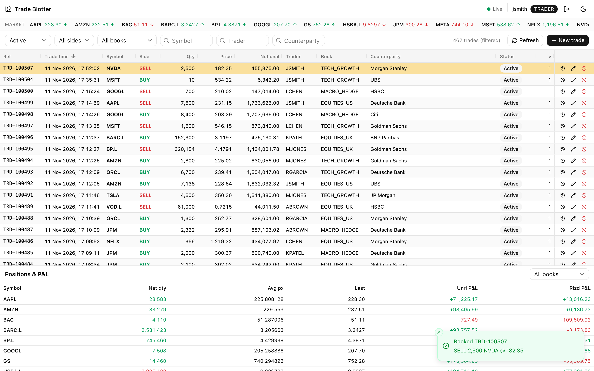
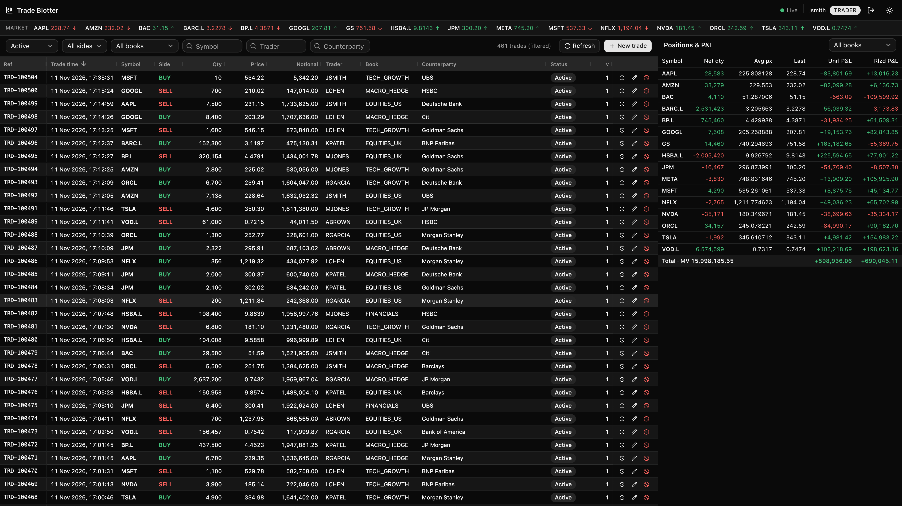
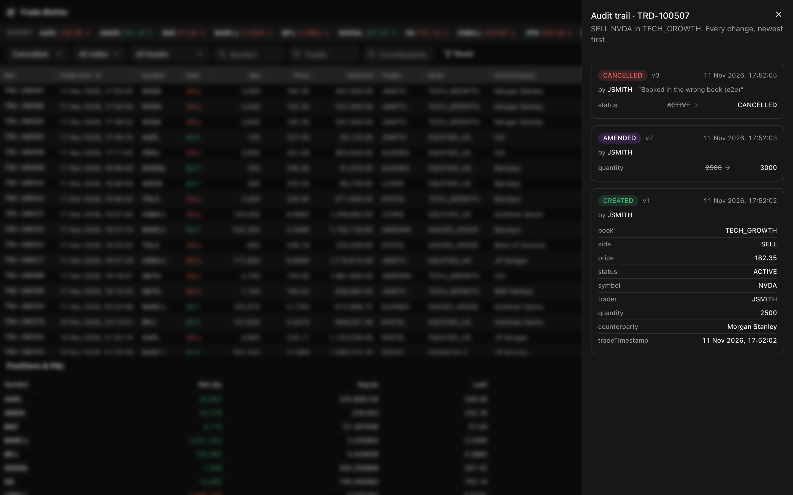
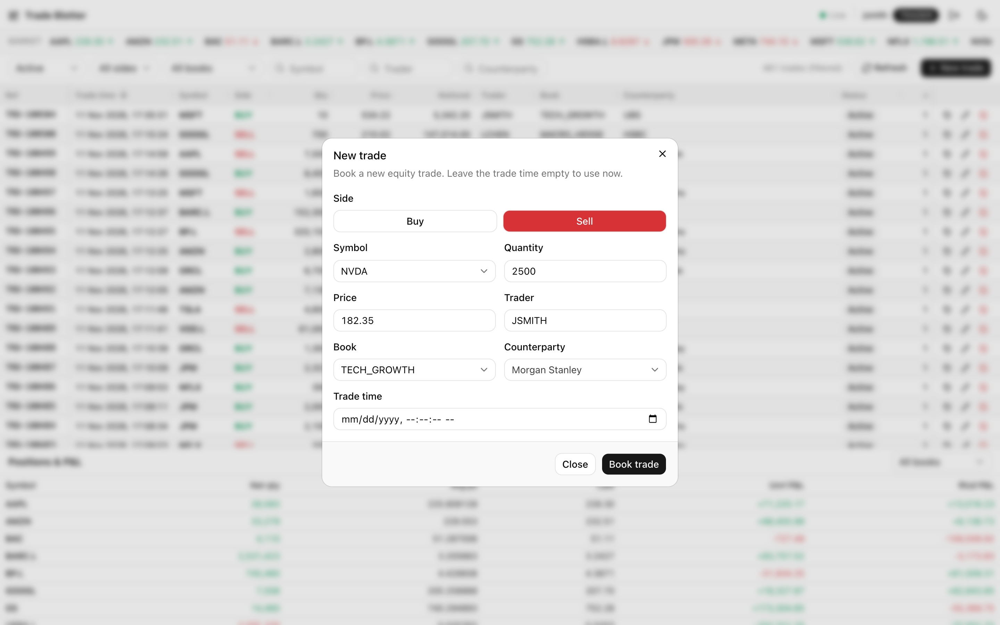

# Trade Blotter

A real-time equity trade blotter: view, create, amend and cancel trades, with every change pushed live to every connected client. It is built as a TypeScript monorepo with a Next.js web app, a NestJS BFF, a NestJS domain service and a Socket.IO realtime server, talking over RabbitMQ and storing data in Postgres.

> **Status:** feature complete and running end to end in Docker: trade CRUD with cancel as a status change, a server-side paged, sorted and filtered grid, live updates across clients, audit trail, positions with realised and unrealised P&L against a mock price ticker, auth with TRADER and VIEWER roles, and light and dark themes. Still to come: the service integration tests against Postgres, CI, and `docs/AI_USAGE.md`.



| Dark theme, wide monitor                                                         | Audit trail                                            | New trade                                                 |
| -------------------------------------------------------------------------------- | ------------------------------------------------------ | --------------------------------------------------------- |
|  |  |  |

More in [docs/screenshots](docs/screenshots).

## Features

- **Blotter grid** (AG Grid Community, infinite row model): paging, sorting and filtering run on the server, rows are virtualised, buy/sell colouring and status badges, and a changed row flashes when an update arrives.
- **Create, amend and cancel** with the shared zod schemas for instant feedback and the service's business rules for the rest. Amend sends the version it started from; if someone else changed the trade first, the form says so and offers Reload. Cancel is final, asks first and records a reason.
- **Live updates:** every client sees creates, amends and cancels within milliseconds over Socket.IO, without reloading. A connection indicator sits in the header, and the app refetches after a reconnect.
- **Audit trail** per trade, with field-level before and after values.
- **Positions and P&L** by symbol (net quantity, average price, realised and unrealised P&L, totals, book filter), and a **price strip** with up and down ticks, both fed by a mock market ticker in the service.
- **Auth:** httpOnly SameSite=Strict cookies with double-submit CSRF, refresh-token rotation with reuse detection, single-use socket tickets. VIEWERs see no write actions, and the service rejects their writes anyway.
- **API docs:** Swagger at <http://localhost:8080/api/docs>.

## Contents

- [Features](#features)
- [Architecture](#architecture)
- [Prerequisites](#prerequisites)
- [Run with Docker](#run-with-docker)
- [Run locally for development](#run-locally-for-development)
- [Tests](#tests)
- [Project layout](#project-layout)
- [Assumptions](#assumptions)
- [Trade-offs](#trade-offs)
- [AI usage](#ai-usage)

## Architecture

```
Browser (Next.js) --HTTP /api--> api (NestJS BFF) --RabbitMQ RPC--> trade service (NestJS) --> Postgres
       ^                                                               |
       +----- WebSocket /socket.io ----- realtime (Socket.IO) <--RabbitMQ emit commands
```

- **web** (`frontend/`): Next.js App Router, used as a client-rendered shell. It proxies `/api` and `/socket.io`, so the browser sees one origin and the httpOnly auth cookies reach the API. UI components are shadcn (base-nova style) on Base UI, in `frontend/src/shared/ui`; add more with `pnpm dlx shadcn@latest add <name>` from `frontend/`.
- **api** (`backend/api/`): a pure BFF. It handles HTTP, `/api/v1` versioning, cookie auth with CSRF, and zod shape validation, and maps service replies to frontend DTOs. It has no business logic and no database.
- **trade service** (`backend/services/trade/`): all business logic. It uses Clean Architecture with CQRS and repositories, one module per business entity, and Prisma for persistence. It is the initial service under `backend/services/`. For now it also hosts audit, positions, pricing and auth, and each module is structured so it can move into its own service there.
- **realtime** (`backend/realtime/`): holds the socket connections and topic groups, and emits only when the service tells it to. Events carry ids, never trade data, and the web refetches through the API.
- **RabbitMQ**: every API to service call is request/reply over the queue, and the API still answers HTTP synchronously. Service to realtime emits are fire-and-forget. Apps depend only on the `MessageBus` interface in `packages/messaging`.

The full design, with C4 diagrams, sequences, the event catalogue, the data model and all 13 decisions, is in [docs/ARCHITECTURE.md](docs/ARCHITECTURE.md).

## Prerequisites

- **Docker** with Compose v2 (Docker Desktop on macOS and Windows). This is the only requirement for running the whole system.
- For local development: **Node.js 24 LTS** (see `.nvmrc`) and **pnpm 10** (`corepack enable` turns it on).

Everything works on macOS, Linux and Windows. Line endings are pinned to LF through `.gitattributes`.

## Run with Docker

```bash
docker compose up --build
```

Then open <http://localhost:8080> and sign in with a demo account (password `password123` for all):

| Username | Role   | Books                    |
| -------- | ------ | ------------------------ |
| `jsmith` | TRADER | all five books           |
| `abrown` | TRADER | EQUITIES_US, TECH_GROWTH |
| `viewer` | VIEWER | read-only                |

If port 5432 is already taken on your machine (for example by another Postgres), choose another host port; the containers still talk to Postgres on 5432 inside the network:

```bash
POSTGRES_PORT=5433 docker compose up --build
```

| Container | Port        | Notes                                                                   |
| --------- | ----------- | ----------------------------------------------------------------------- |
| web       | 8080        | Next.js, proxies `/api` and `/socket.io`                                |
| api       | 3000        | `/api/v1`, Swagger at `/api/docs`, health at `/api/v1/health`           |
| realtime  | 3001        | `GET /health`                                                           |
| service   | none        | Applies migrations, seeds users, prices and 500 trades on first start   |
| postgres  | 5432        | Named volume `postgres-data`; host port set by `POSTGRES_PORT`          |
| rabbitmq  | 5672, 15672 | Management UI at <http://localhost:15672> (login `blotter` / `blotter`) |

Health checks control the start order. To start again from an empty database, run `docker compose down -v`.

Defaults work out of the box. To change ports or credentials, copy `.env.example` to `.env`.

## Run locally for development

```bash
corepack enable
pnpm install

# Infrastructure only
docker compose up -d postgres rabbitmq

# Database
cp .env.example .env
pnpm --filter @blotter/database exec prisma migrate deploy

# All apps in watch mode (web on :8080, api on :3000, realtime on :3001)
pnpm dev
```

Useful commands:

| Command                                              | What it does                                           |
| ---------------------------------------------------- | ------------------------------------------------------ |
| `pnpm build`                                         | Builds every workspace in dependency order (Turborepo) |
| `pnpm typecheck`                                     | Runs TypeScript across the repo                        |
| `pnpm lint`                                          | Runs ESLint across the repo                            |
| `pnpm format`                                        | Runs Prettier                                          |
| `pnpm --filter @blotter/database exec prisma studio` | Opens a browser view of the database                   |

## Tests

```bash
pnpm test               # unit tests in every workspace (Vitest)
pnpm test:integration   # integration tests against real RabbitMQ (needs Docker)
```

| Workspace                | Tests | What is covered                                                                                                                                                                                           |
| ------------------------ | ----: | --------------------------------------------------------------------------------------------------------------------------------------------------------------------------------------------------------- |
| `packages/contracts`     |    26 | zod schemas (validation rules, defaults, query parsing), error-code-to-HTTP mapping, event catalogue                                                                                                      |
| `packages/messaging`     |    14 | In-memory bus semantics (replies, coded errors, timeouts, correlation ids, events); integration tests run RabbitMQ in Testcontainers                                                                      |
| `database`               |     6 | Random trade generator: reproducible, valid against the create-trade rules, weekdays and session hours only                                                                                               |
| `backend/services/trade` |    69 | Trade aggregate rules, price walk bounds, position and P&L maths, every command and query handler with in-memory fakes (login, refresh rotation and reuse, socket tickets, ticks), bcrypt and JWT         |
| `backend/api`            |    21 | Supertest against an in-memory fake service: cookie flags, CSRF, 400/401/403/404/409 mapping, DTO mapping, the Actor taken from the session, Swagger                                                      |
| `backend/realtime`       |    10 | A real Socket.IO server with socket.io-client: refused and single-use tickets, group join, subscribe acks, emit to group, client and all, session-expiry disconnect                                       |
| `frontend`               |    30 | Vitest + Testing Library: API client (CSRF, refresh-and-retry, errors), realtime client and hooks, login form, trade form (validation, amend diff, 409 reload), audit trail, positions table, price ticks |

The full flow was also checked in a real browser with Playwright against the Docker stack: sign in, create, amend and cancel a trade as `jsmith` while a second browser signed in as `viewer` sees each change live; the screenshots in `docs/screenshots` come from that run.

`docker-compose.test.yml` provides throwaway Postgres and RabbitMQ instances on separate ports for the service integration tests.

## Project layout

```
frontend/            Next.js web app (shadcn on Base UI in src/shared/ui)
backend/api/         NestJS BFF
backend/services/    NestJS domain services (trade is the initial one)
backend/realtime/    NestJS + Socket.IO
database/            Prisma schema, migrations, seed data generator
packages/contracts/  Shared types, zod schemas, RPC catalogue, realtime events
packages/messaging/  MessageBus interface, RabbitMQ and in-memory adapters
packages/config/     Shared tsconfig, ESLint and Vitest presets
docs/                Architecture, AI usage report, prompt log
```

## Assumptions

- **Trades:** a trade is a single equity execution with symbol, side, quantity, price, trader, book, counterparty and timestamp. Every business field can be amended. Cancelling sets the status to `CANCELLED` and is final.
- **Quantity and price:** quantity is a whole number of shares. Price is positive with up to 6 decimal places, stored as `Decimal(18, 6)`.
- **Seed data:** when the trades table is empty, 500 random trades are generated, spread over the last five business days during 08:00 to 16:30 UTC, with about 8% cancelled.
- **Reference data:** symbols, books and counterparties are constants in `packages/contracts` rather than database tables.
- **Market prices:** P&L uses a mock price ticker inside the service, not a real market data feed.
- **Users:** auth is role-based only. TRADER can write into the books they are entitled to and VIEWER is read-only. Demo users are seeded with bcrypt-hashed passwords.
- **P&L:** average-cost method over active trades; realised P&L is the matched quantity at (average sell - average buy), unrealised marks the open quantity to the latest mock price.

## Trade-offs

- **A queue between the API and the service** adds a hop and latency for a small app. It is there so the BFF, the domain service and realtime can scale and split independently, which is the architecture this exercise is meant to show.
- **No outbox:** events are emitted right after the database commit. If the service dies between the commit and the emit, an event is lost. Clients recover because they refetch on reconnect and on Refresh.
- **Thin events and refetching:** realtime events carry ids only, which costs an extra API call per change. In return, trade data never travels over the socket and authorisation always runs in one place.
- **Computed positions:** net positions and P&L are calculated per request with SQL `GROUP BY`. That is cheap at 1,000 trades, but would need a projection at scale.
- **TypeScript 6.0, not 7:** TS 7 has no stable JS API yet, and typescript-eslint and the Nest CLI don't support it.

## AI usage

This project was built with Claude Code. Jenerson made the architecture and product decisions, and Claude proposed options and wrote the code and tests. See [docs/PROMPT_LOG.md](docs/PROMPT_LOG.md). The AI usage report will be in `docs/AI_USAGE.md`.
