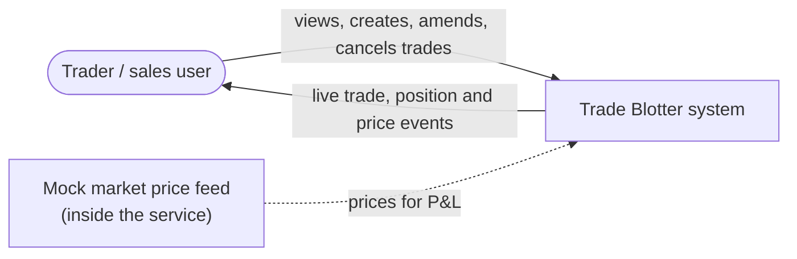
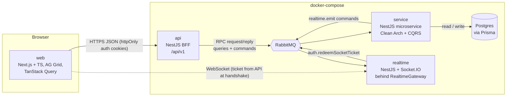
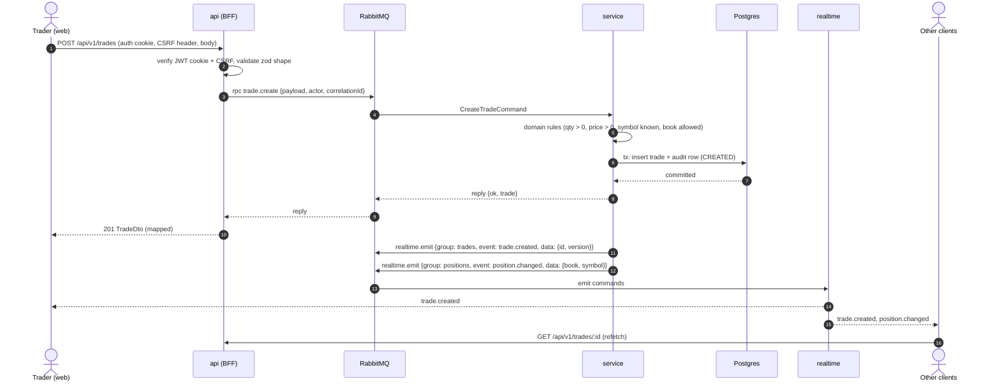
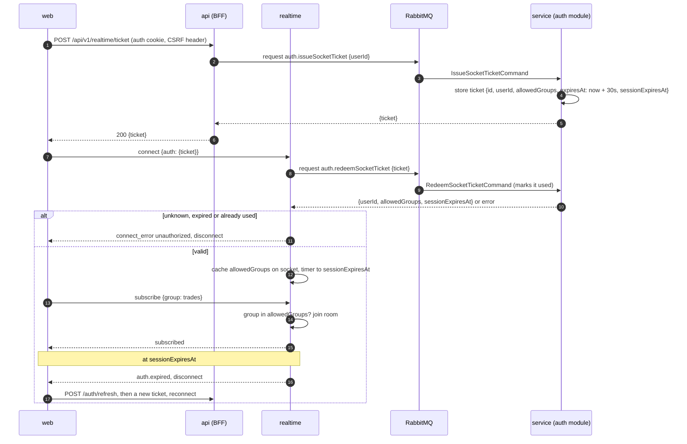
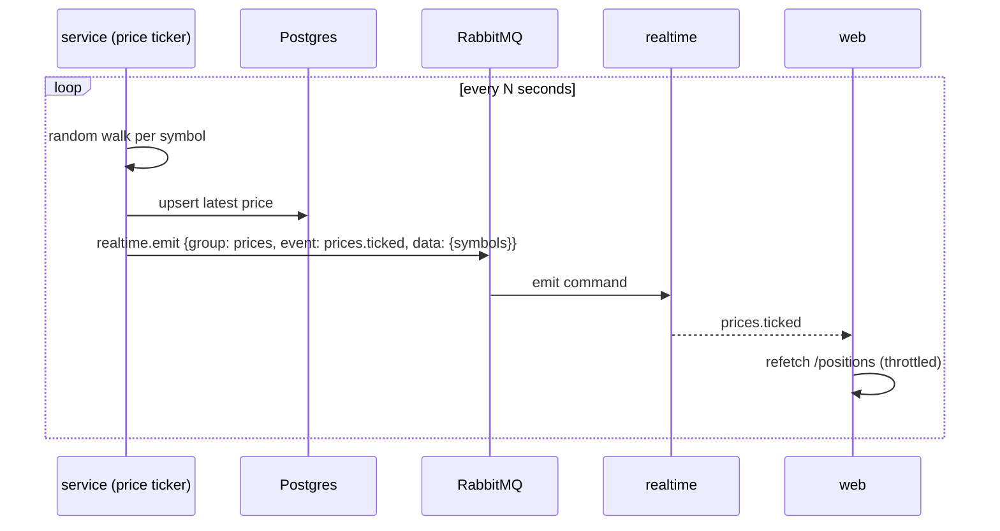

# Trade Blotter Architecture

Nov 11, 2026 · @Jenerson

## Overview

The blotter is four deployables plus RabbitMQ and Postgres: a Next.js web app, a NestJS API (BFF), one domain service, and a realtime gateway, each in its own container. Every API to service call and every service to realtime command goes over RabbitMQ, so each part can scale or split without touching the others. Jenerson signed this design off on 2026-11-11; every decision is listed at the end.

**Scope from the brief:** trade CRUD (create, amend, cancel as a status change), a sortable and filterable grid, refresh from the API, live updates across clients, 100 to 1,000 seeded random trades on first start, unit and integration tests, Docker, README, AI usage report and prompt log. **Bonus, all in scope:** audit trail, position summary, P&L, auth, validation rules, virtualised grid.

### Decisions already made

| Area | Decision |
| --- | --- |
| Flow | Frontend -> API -> RabbitMQ -> Service -> Postgres / Realtime |
| API | NestJS, versioned endpoints, pure BFF: no business logic, no DB, no realtime. Shape validation with zod schemas from the contracts package, shared with the web forms. Maps service results to frontend DTOs. |
| Transport | All API -> Service traffic (queries and commands) is RabbitMQ request/reply; the API answers HTTP synchronously. Service -> Realtime emit commands also go over RabbitMQ. |
| Service | All business logic and business-rule validation. Clean Architecture + CQRS + repository pattern, one module per business entity, Prisma + Postgres. One process at first, split-ready. |
| Realtime | Separate server that emits only on service command. Events carry a type and minimal non-sensitive data; the frontend refetches through the API. Socket.IO sits behind an interface. Exposes emitToClient, emitToGroup, broadcast. Topic groups only, never per-user fan-out. |
| Amend | Update the trade row in place and write audit trail rows (confirmed by Jenerson). |
| P&L | Mock market price ticker inside the service, emitting to a prices group (confirmed by Jenerson). |
| Frontend | Feature-based folders, shared components, Next.js (App Router), shadcn + Tailwind on Base UI (not Radix). AG Grid and TanStack Query suggested. Realtime is used for events only. |
| Contracts | Shared TypeScript package for types, message patterns and the event catalogue. |
| Delivery | GitHub monorepo with docker-compose. |
| Socket auth | **Decided:** the API issues a single-use socket ticket, realtime redeems it with the service, caches allowed groups, disconnects at session expiry (see Sequences). |

## C4 context and containers

The trader only ever talks HTTP to the API and holds one socket to Realtime; nothing else is reachable from the browser.

### Context (level 1)



### Containers (level 2)



| Container | Owns | Does not do |
| --- | --- | --- |
| web | UI state, grid, forms, socket subscription, cache invalidation | Business rules beyond form hints |
| api | HTTP, versioning, JWT cookie and CSRF check, zod shape validation, socket ticket requests, mapping to frontend DTOs, error mapping to HTTP codes | Business logic, DB, realtime |
| service | Domain rules, persistence, audit, positions, P&L, price ticker, auth (users, tokens), deciding who gets which event | HTTP, sockets |
| realtime | Socket connections, group membership, emitting on command | Deciding what to emit or to whom; any DB access |
| RabbitMQ | RPC queues and the emit command queue |  |
| Postgres | Trades, audit, users, prices |  |

## Sequences

The HTTP reply and the realtime event travel separate paths: the API answers the caller from the RPC reply, while every client (including the caller) learns about the change from the event and refetches.

### Create trade



Amend and cancel follow the same path with `trade.amend` / `trade.cancel`, an optimistic `version` check, an audit row holding the before and after values, and `trade.updated` / `trade.cancelled` events.

### Socket auth

Every permission decision starts from an API call: the API gets a short-lived, single-use ticket from the service, and realtime only redeems it.



### Price tick and P&L



## Monorepo layout

One pnpm workspace with Turborepo, laid out with the brief's deliverable folders (`frontend/`, `backend/`, `database/`, `docker-compose.yml` at the root); the shared packages are the only code the apps share.

```
trade-blotter/
  frontend/              Next.js (App Router) + TS
  backend/
    api/                 NestJS BFF (HTTP, /api/v1)
    service/             NestJS microservice (RabbitMQ transport), all domains
    realtime/            NestJS + Socket.IO gateway, behind RealtimeGateway
  database/
    prisma/              schema.prisma, migrations/
    seed/                random trade generator (100-1,000 trades), run by the service on first start
  packages/
    contracts/           message patterns, event catalogue, request/response types, zod schemas
    messaging/           MessageBus interface (request, publish) + RabbitMQ and in-memory adapters,
                         correlation ids, timeouts, error envelope
    config/              shared tsconfig, eslint, prettier, vitest presets
  docker-compose.yml     postgres, rabbitmq, service, api, realtime, frontend
  docker-compose.dev.yml
  docker-compose.test.yml
  docs/
    ARCHITECTURE.md      this document
    AI_USAGE.md
    PROMPT_LOG.md
  pnpm-workspace.yaml
  turbo.json
  README.md
```

**packages/contracts** holds, per domain: `patterns.ts` (string constants such as `trade.create`), `*.request.ts` and `*.response.ts` types, and `events.ts` (event name, group, payload type). The API, service and realtime import from it; web imports only the event catalogue and frontend DTO types, never service internals.

## Service module structure

Each business entity is a self-contained module with the same four layers, and modules talk to each other only through domain events or their application ports, so any module can later move into its own process.

```
backend/service/src/
  main.ts                          RabbitMQ microservice bootstrap
  shared/
    domain/                        Entity, ValueObject, DomainEvent, Result, DomainError
    infrastructure/
      prisma/                      PrismaService, transaction helper (unit of work)
      realtime/                    RealtimePublisher port, implemented with MessageBus.publish
  modules/
    trades/
      domain/                      Trade aggregate, Side, TradeStatus, Money, Quantity,
                                   TradeRules, TradeRepository (port), events
      application/
        commands/                  CreateTrade, AmendTrade, CancelTrade (+ handlers)
        queries/                   ListTrades, GetTrade (+ handlers)
        event-handlers/            on TradeChanged -> notify realtime
      infrastructure/              PrismaTradeRepository, PrismaTradeReadModel
      interface/                   TradesRpcController (@MessagePattern)
    audit/                         AuditEntry, writes on trade events, ListAuditForTrade query
    positions/                     GetPositions query (aggregate over active trades + latest price)
    pricing/                       PriceTicker (scheduler), Price repository, GetPrices query
    auth/                          User, Login, Refresh, IssueSocketTicket, RedeemSocketTicket, password hashing, JWT
    seed/                          seeds 500 random trades when the table is empty
```

| Layer | Depends on | Holds |
| --- | --- | --- |
| domain | nothing | Aggregates, value objects, business rules, repository interfaces |
| application | domain | CQRS command and query handlers (`@nestjs/cqrs`), orchestration, transactions |
| infrastructure | application, domain | Prisma repositories, RabbitMQ realtime adapter, clock, id generator |
| interface | application | `@MessagePattern` controllers mapping contracts to commands and queries |

**Command side** loads the aggregate through the repository, applies rules, saves, and publishes domain events. **Query side** reads through a thin read model straight from Prisma for sorting, filtering and paging, without hydrating aggregates. Both use the same Postgres tables; no separate read store.

## Messages and events

There are two RabbitMQ channels: an RPC queue the service consumes (request/reply with correlation ids, 5 s timeout at the API), and a `realtime.commands` queue the realtime server consumes (fire and forget). Emits are sent right after the DB transaction commits, with no outbox: an event can be lost if the service dies in between, which is acceptable here because clients refetch on reconnect and on Refresh.

### Messaging abstraction

No app touches RabbitMQ directly: the api, service and realtime all depend on a `MessageBus` interface from `packages/messaging`, with RabbitMQ as one adapter behind it (same idea as the RealtimeGateway).

```ts
interface MessageBus {
  // request/response: waits for a reply (API -> service queries and commands, realtime -> auth.redeemSocketTicket)
  request<TReq, TRes>(pattern: string, payload: TReq, opts?: { timeoutMs?: number }): Promise<TRes>;
  // fire and forget: no reply (service -> realtime emit commands, domain event publishing)
  publish<T>(topic: string, payload: T): Promise<void>;
  // consumer side
  handle<TReq, TRes>(pattern: string, handler: (payload: TReq, ctx: MessageContext) => Promise<TRes>): void;
  subscribe<T>(topic: string, handler: (payload: T, ctx: MessageContext) => Promise<void>): void;
}
```

The RabbitMQ adapter implements `request` with a reply-to queue and correlation id, and `publish` with a topic exchange. An in-memory adapter backs unit tests. Both carry the same envelope and correlation id for tracing.

### RPC message patterns (API or realtime -> service)

| Pattern | Kind | Request | Reply |
| --- | --- | --- | --- |
| `trade.list` | query | filters, sort, page | `{items, total}` |
| `trade.get` | query | `{id}` | `Trade` |
| `trade.create` | command | `CreateTradeInput`, actor | `Trade` |
| `trade.amend` | command | `{id, version, changes}`, actor | `Trade` |
| `trade.cancel` | command | `{id, version, reason?}`, actor | `Trade` |
| `audit.listForTrade` | query | `{tradeId}` | `AuditEntry[]` |
| `position.list` | query | `{book?}` | `Position[]` with unrealised P&L, by symbol |
| `price.list` | query | `{symbols?}` | `Price[]` |
| `auth.login` | command | `{username, password}` | `{accessToken, refreshToken, expiresAt}` (API sets them as cookies) |
| `auth.refresh` | command | `{refreshToken}` | new tokens |
| `auth.logout` | command | `{refreshToken}` | revokes it |
| `auth.issueSocketTicket` | command | `{userId}` (from the verified cookie) | `{ticket, expiresAt}` |
| `auth.redeemSocketTicket` | command (sent by realtime) | `{ticket}` | `{userId, allowedGroups, sessionExpiresAt}` |

Every reply uses one envelope: `{ok: true, data}` or `{ok: false, error: {code, message, details?}}`. Codes such as `VALIDATION_FAILED`, `NOT_FOUND`, `VERSION_CONFLICT`, `INVALID_STATE` map to 422, 404, 409 and 409 at the API.

### Realtime commands (service -> realtime)

| Command | Payload |
| --- | --- |
| `realtime.emitToGroup` | `{group, event, data}` |
| `realtime.emitToClient` | `{socketId, event, data}` |
| `realtime.broadcast` | `{event, data}` |

### Event catalogue (realtime -> web)

| Event | Group | Data | Web reaction |
| --- | --- | --- | --- |
| `trade.created` | `trades` | `{id, version}` | Invalidate trade list |
| `trade.updated` | `trades` | `{id, version}` | Refetch that trade if version is newer |
| `trade.cancelled` | `trades` | `{id, version}` | Refetch that trade |
| `position.changed` | `positions` | `{book, symbol}` | Invalidate positions |
| `prices.ticked` | `prices` | `{symbols, asOf}` | Refetch prices and positions, throttled |
| `auth.expired` | client | `{}` | Refresh session, get a new ticket, reconnect |

No event carries prices, quantities, counterparties or trader names; the web always refetches through the API.

## Prisma data model

Six tables: trades are updated in place with an optimistic `version`, and every change appends one immutable `TradeAudit` row holding the before and after snapshots.

```prisma
enum Side        { BUY  SELL }
enum TradeStatus { ACTIVE  CANCELLED }
enum AuditAction { CREATED  AMENDED  CANCELLED }
enum Role        { TRADER  VIEWER }

model Trade {
  id             String      @id @default(uuid())
  tradeRef       String      @unique          // "TRD-100001"
  symbol         String
  side           Side
  quantity       Int
  price          Decimal     @db.Decimal(18, 6)
  trader         String                       // trader code, e.g. JSMITH
  book           String
  counterparty   String
  tradeTimestamp DateTime
  status         TradeStatus @default(ACTIVE)
  version        Int         @default(1)
  createdAt      DateTime    @default(now())
  updatedAt      DateTime    @updatedAt
  createdById    String?
  audits         TradeAudit[]
  @@index([status, tradeTimestamp])
  @@index([book, symbol])
  @@index([trader])
}

model TradeAudit {
  id        String      @id @default(uuid())
  tradeId   String
  trade     Trade       @relation(fields: [tradeId], references: [id])
  action    AuditAction
  version   Int                               // trade version after the change
  before    Json?
  after     Json
  changed   String[]                          // field names that changed
  actorId   String
  reason    String?
  at        DateTime    @default(now())
  @@index([tradeId, at])
}

model Price {
  symbol    String   @id
  price     Decimal  @db.Decimal(18, 6)
  asOf      DateTime
}

model User {
  id           String   @id @default(uuid())
  username     String   @unique
  passwordHash String
  traderCode   String   @unique
  role         Role     @default(TRADER)
  books        String[]                       // books the user may trade
  createdAt    DateTime @default(now())
}

model SocketTicket {
  id               String    @id              // random 256-bit value, hashed
  userId           String
  allowedGroups    String[]
  expiresAt        DateTime                    // issue time + 30 s
  sessionExpiresAt DateTime                    // access token expiry
  usedAt           DateTime?
}

model RefreshToken {
  id        String   @id @default(uuid())
  userId    String
  tokenHash String   @unique
  expiresAt DateTime
  revokedAt DateTime?
}
```

**Positions are computed, not stored:** net quantity and average price per symbol over ACTIVE trades, as the brief asks (net positions and aggregate P&L by symbol), with an optional book filter, with unrealised P&L = net quantity x (latest price - average price). At 1,000 trades a SQL `GROUP BY` on demand is cheap, so no positions table is kept.

**Reference data** (symbols, books, counterparties) lives as constants in the contracts package for now, which keeps validation and seeding simple.

## API endpoints (v1)

All routes sit under `/api/v1` using NestJS URI versioning, need the access-token cookie except login and refresh, require an \`X-CSRF-Token\` header on every write, and map one to one onto an RPC pattern.

| Method | Path | RPC pattern | Notes |
| --- | --- | --- | --- |
| POST | `/auth/login` | `auth.login` | Sets access and refresh tokens as httpOnly, Secure, SameSite=Strict cookies, plus a readable CSRF cookie (double-submit) |
| POST | `/auth/refresh` | `auth.refresh` |  |
| POST | `/auth/logout` | `auth.logout` | Revokes refresh token, clears cookies |
| POST | `/realtime/ticket` | `auth.issueSocketTicket` | Single-use socket ticket, valid 30 s |
| GET | `/trades` | `trade.list` | `?status&symbol&side&book&trader&from&to&sort=-tradeTimestamp&page&pageSize` |
| GET | `/trades/:id` | `trade.get` |  |
| POST | `/trades` | `trade.create` | 201 |
| PATCH | `/trades/:id` | `trade.amend` | Body includes `version`; 409 on conflict |
| POST | `/trades/:id/cancel` | `trade.cancel` | Explicit action rather than DELETE, since the row stays |
| GET | `/trades/:id/audit` | `audit.listForTrade` | Audit trail panel |
| GET | `/positions` | `position.list` | Net qty, avg price, last price, unrealised P&L by symbol |
| GET | `/prices` | `price.list` |  |
| GET | `/health` | none | Checks RabbitMQ connection |

**Errors** use one JSON shape, `{statusCode, code, message, details?}`, produced by a global exception filter that maps service error codes to HTTP. **Docs:** Swagger at `/api/docs` generated from the zod schemas.

## Frontend structure

The web app is organised by feature; the socket only invalidates TanStack Query caches, so every piece of data on screen comes from the API.

```
frontend/src/
  app/                 Next.js routes (/login, /blotter), root layout, client providers (QueryClient, Auth, Realtime)
  features/
    auth/              login page, session state, refresh-on-401, CSRF header (tokens are never visible to JS)
    trades/            blotter grid, filters bar, create/amend dialog, cancel confirm,
                       hooks: useTrades, useTrade, useCreateTrade, useAmendTrade, useCancelTrade
    audit/             audit trail drawer per trade
    positions/         position summary panel with P&L
    prices/            price strip / ticker
  shared/
    ui/                shadcn components built on Base UI (Button, Dialog, Select, Toast...)
    api/               typed fetch client, error mapping
    realtime/          RealtimeClient interface + Socket.IO adapter, useRealtimeEvent hook
    lib/               formatters (money, qty, dates), zod form schemas
```

- **Grid:** AG Grid Community with row virtualisation, column sort and filter, status pill, flash on updated rows. Sorting, filtering and paging run on the server: AG Grid's infinite row model (Community) passes sort, filter and page to GET /trades, so the browser only holds the pages in view.
- **Forms:** react-hook-form + zod schemas from contracts for instant shape feedback; business errors from the API show inline.
- **Realtime:** one connection after login; subscribes to `trades`, `positions`, `prices`. On event, invalidate the matching query keys, throttling `prices.ticked` to one refetch per second.
- **UX:** loading skeletons, empty and error states, toasts on success and conflict, a manual Refresh button as the brief asks, connection status indicator.

**Next.js and the BFF rule:** Next.js runs as the web shell only. Blotter pages are client components; there are no server actions or route handlers that call the service or RabbitMQ, so the NestJS API stays the one BFF. `next.config` rewrites `/api` and `/socket.io` to the api and realtime containers, giving the browser a single origin, so the httpOnly auth cookies reach the API; the socket authenticates with a ticket instead. Server-side rendering is limited to the static shell (layout, login page).

## Testing and Docker

Most tests sit in the service domain and application layers, where the rules live; integration tests then prove each hop over real RabbitMQ and Postgres.

| Level | Tool | What it covers |
| --- | --- | --- |
| Unit: domain | Vitest | Trade rules (qty and price > 0, cannot amend or cancel a CANCELLED trade, version bump), value objects, P&L maths, price random walk bounds |
| Unit: application | Vitest + in-memory repositories | Command and query handlers, audit row written, realtime publisher called with the right group and event |
| Unit: api | Vitest + Nest testing module | zod request validation, mapping to frontend DTOs, error code to HTTP mapping, with the RPC client mocked |
| Unit: realtime | Vitest | Group join checks against allowedGroups, expiry disconnect, gateway interface with a fake adapter |
| Unit: web | Vitest + Testing Library + MSW | Forms, filter bar, event-to-invalidation hook |
| Integration: service | Testcontainers (Postgres, RabbitMQ) | Prisma repositories, RPC round trip, transaction rollback leaves no audit row |
| Integration: api | Supertest against api + service + containers | Each endpoint end to end through RabbitMQ |
| End to end (optional) | Playwright on docker-compose | Two browsers: create in one, see it appear in the other |

**CI:** a GitHub Actions workflow running lint, typecheck, unit and integration tests.

**Docker:** every component runs in its own container, and `docker compose up` is the only command needed to run the whole system:

| Container | Image | Notes |
| --- | --- | --- |
| postgres | postgres:16 | Named volume, health check |
| rabbitmq | rabbitmq:3-management | Management UI on 15672 |
| service | multi-stage Node build | Runs `prisma migrate deploy`, seeds if the trades table is empty, then starts |
| api | multi-stage Node build | Port 3000, waits for rabbitmq |
| realtime | multi-stage Node build | Port 3001, waits for rabbitmq |
| web | Next.js standalone build (output: standalone) | Port 8080, proxies `/api` and `/socket.io` so the browser uses one origin |

A `docker-compose.dev.yml` override mounts the source with hot reload, and `docker-compose.test.yml` runs the integration suite against throwaway postgres and rabbitmq containers. Health checks gate start order; `.env.example` lists every variable.

## Decisions

All thirteen choices are decided as of 2026-11-11; nothing is open.

### Decided

| # | Question | Decision |
| --- | --- | --- |
| 1 | Socket auth flow | Ticket flow: the web asks the API for a single-use socket ticket (issued by the service), then connects to realtime with it; realtime redeems it with the service, caches allowedGroups, disconnects at session expiry |
| 2 | Event reliability | Emit right after the DB commit; no outbox |
| 3 | Realtime server | NestJS app with a Socket.IO gateway, behind the RealtimeGateway interface |
| 4 | RabbitMQ library | `@nestjs/microservices` RMQ transport in all three Nest apps, behind the MessageBus interface (request, publish) |
| 5 | Grid data loading | Server-side paging, sorting and filtering through `GET /trades` |
| 6 | Positions | Computed per request: net quantity, average price and unrealised P&L grouped by symbol |
| 7 | Amendable fields | Every business field: symbol, side, quantity, price, trader, book, counterparty, tradeTimestamp. Id, tradeRef and status are fixed |
| 8 | Cancel | CANCELLED is final, no reinstate |
| 9 | Auth scope | Seeded users with roles TRADER (write) and VIEWER (read) |
| 10 | Token storage | Access and refresh tokens both in httpOnly, SameSite=Strict cookies, with double-submit CSRF protection on writes |
| 11 | Shape validation | zod schemas in the contracts package, used by the API and the web forms |
| 12 | Repo layout and tooling | pnpm workspaces + Turborepo + Vitest, folders named as the brief lists them |
| 13 | Frontend framework | Next.js (App Router) as a client-rendered shell; the NestJS API stays the only BFF |

### Next step

Signed off by Jenerson on 2026-11-11. This doc becomes `docs/ARCHITECTURE.md` in the repo, and the build starts with the shared packages (contracts, messaging) and `docker-compose.yml`.

The AI usage report and prompt log will record these choices as Jenerson's decisions, with the options Claude put forward.
